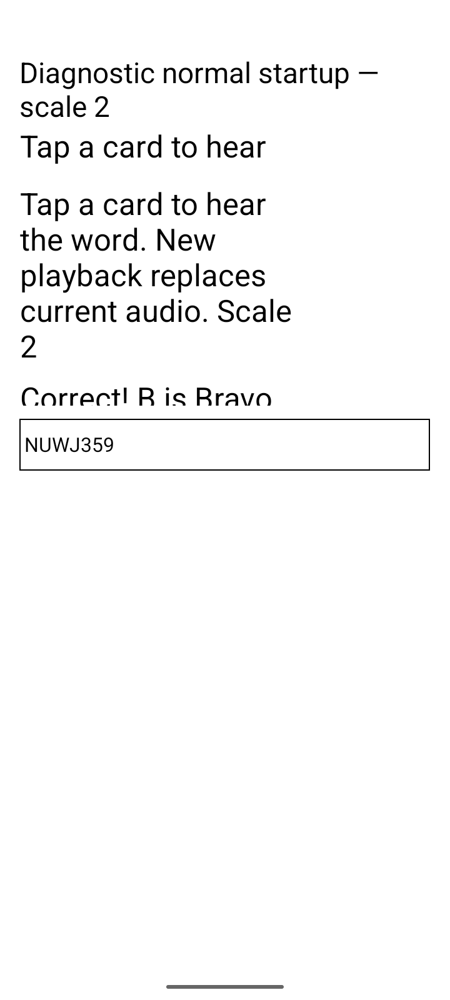
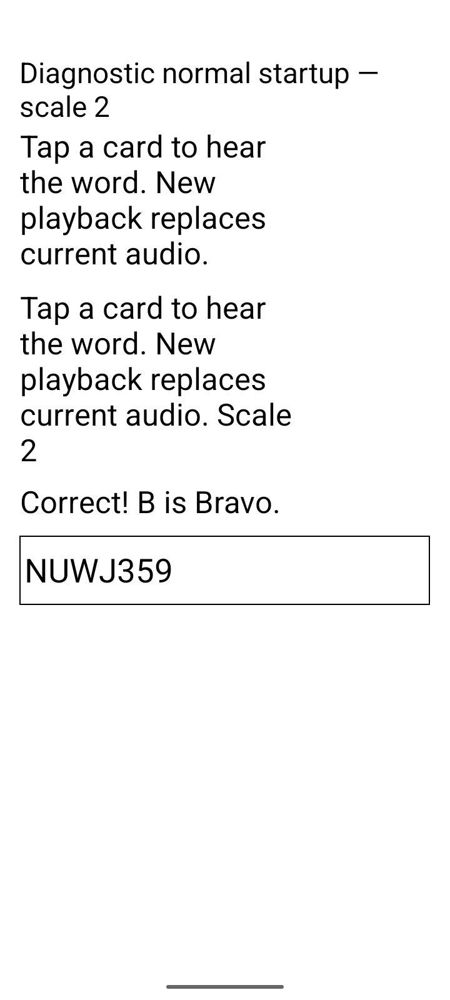
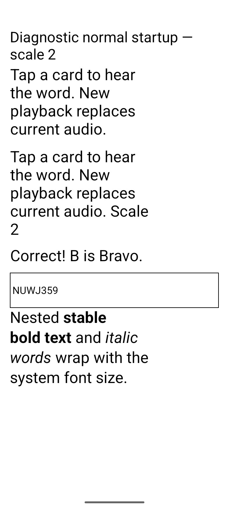
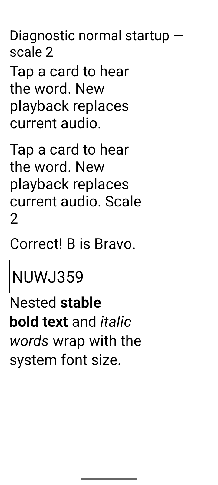
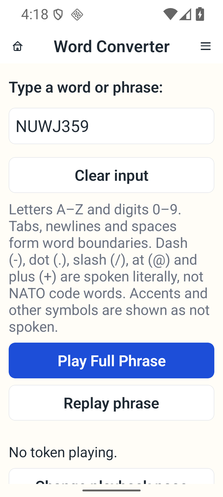
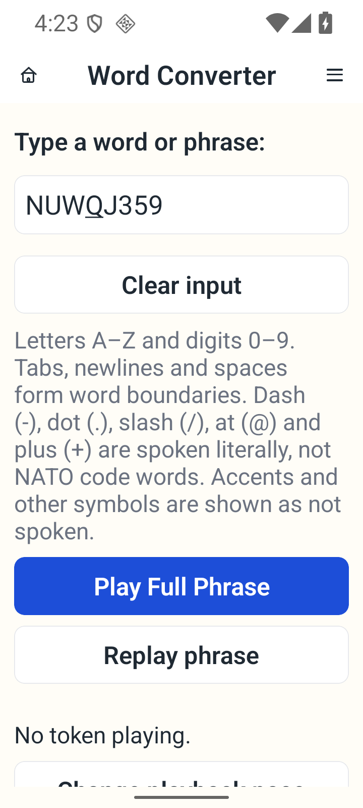

# Android live font sizing: issue, repair candidates and evidence

**P05.2 / P1 · Evidence through Run28 · 20 November 2026**

**Current conclusion:** an opt-in Android source candidate repairs the observed failures in the tested ARM64 Debug and scoped ARM64 Release configurations. All configured source Release ABIs now have compile/package/link qualification; non-ARM64 execution and full Release affected gates are unrun. The ordinary build still uses the original Maven framework and retains the bug. P05.2 is active; this is not a completed release fix.

This report explains the issue, shows actual screenshots, traces the repair candidates, and separates passing checks, persistent failures, test-tool failures and untested risks. It adds analysis of existing evidence; no application code, build, emulator test or acceptance result is changed by preparing it. The archived [Run26 PDF edition](evidence/run26/reports/android-font-scale-p1.pdf) embeds the original screenshot examples and retains its dated Run26 status. This Markdown report adds the later Run27 qualification; the archived PDF is unchanged.

**Run28 update:** three remaining source Release ABI APK/AAB builds and native consumer links pass with exact JS/Hermes/ELF/prefab/header identity. The ABI-selectable helper handles32/64-bit generation encodings, rejects wrong architecture/mode/headers and passes fresh6 native cases on exact ARM64 Release libraries. Metro honors explicit shared worker limits after an actual setup/write failure; an emulator disk rejection is also retained. Scoped retries/resource recovery,8 tests/lint and4 inspected actual images pass. Full Release/default integration/additional-ABI runtime remain open. [Evidence](evidence/run28/README.md), [captures](evidence/run28/screenshots/index.md).

**Run27 update (retained scope):** the original complete current-source F1 tile scope now passes625 native baselines/271 ink observations. Unsigned ARM64 source Release build,6 native causal cases and5 real-product composition checkpoints pass. No product/native repair source changed; test helpers now match Debug/Release ABIs and retrieve non-debuggable evidence. Other ABIs/full Release/default integration remain open. [Reports and limitations](evidence/run27/README.md), [25 actual captures](evidence/run27/screenshots/index.md).

| Question | Answer |
|---|---|
| What breaks? | After changing Android's system font size while the app is open, some unchanged text keeps its old layout size. Enlarged glyphs clip, and editable input can keep small glyphs even after its frame grows. |
| What is the repair? | Keep the actual font environment consistent across surface layout, Yoga subtree reuse, text measurement caches and the native editable widget. These are separate boundaries, not one cache bug. |
| Does the final candidate pass? | Yes in recorded ARM64 Debug scopes, now including complete F1 baseline/ink checks; scoped ARM64 Release build/native/composition checks also pass. Full Release and default integration remain open. |
| Does the default app build include it? | No. Source compilation is explicitly selected; default-build integration is unfinished. |
| What new failure does the final repair demonstrably introduce? | No new application regression has been demonstrated in its executed acceptance scopes. This does not establish safety in untested configurations. Intermediate candidates and test/build tools did fail, as detailed below. |
| Why is it still P1? | Existing ordinary builds remain affected, and other source ABIs, full Release affected gates and default integration are unfinished. |

## 1. The issue in ordinary use

The user opens a screen, enters text or submits a quiz answer, then increases Android's system font size without closing the app. Existing paragraphs, feedback, buttons and inputs must adapt while retaining the current screen, typed value, selection and quiz state.

The failure is a disagreement between **the space allocated to text** and **the text actually drawn inside it**. Some labels receive enlarged glyphs but retain the old short frame, so words are cut off. A separate input path can retain its old glyph size. Restarting at the larger setting can produce the correct result, which is why a cold-start-only check misses this P1.

This is an accessibility failure: readable feedback and action labels are necessary to use the learning flows. It is distinct from the separately tracked small raster fringes on some decorative NATO tile text.

The reproduction compares:

1. **Cold1:** start at system font scale 1.
2. **Live2:** change to scale 2 in the same mounted screen.
3. **Return1:** change back to 1 without resetting that screen.
4. **Cold2:** separately start at 2 as the reference for the same text.

Live2 should match Cold2 within **one physical pixel** for the checked heights. Return1 should match Cold1. Retaining input or exposing the right accessibility label alone does not establish that the text is readable.

**Terms used below:** a **frame** is the allocated rectangle; **glyphs** are the drawn letters; **dp** describes logical layout units; **SP conversion** turns Android's scalable text units into pixels. A **dirty** layout node needs recalculation, and an **environment generation** identifies a changed font-conversion environment. The check compares live and cold at the same setting; it does not assume every frame must exactly double in height, because larger words wrap into more lines.

### Original measurements

The original Run20 trace and the Run26 Maven control reproduce these differences. Values are layout heights in **dp**, rounded here; the JSON preserves full precision.

| Control | Original Live2 | Original Cold2 | Result and interpretation |
|---|---:|---:|---|
| Unchanged paragraph | 40.571 | 135.429 | FAIL: the enlarged paragraph retains the old short frame. |
| Unchanged feedback with explicit line height | 24.000 | 36.000 | FAIL: enlarged feedback clips. |
| Input outer frame | 47.429 | 63.429 | FAIL: input measurement reuses the old size. |
| Paragraph whose text changes with the scale | 168.000 | 168.000 | PASS: changing the text triggers fresh measurement. This is a useful control, not a workaround. |

Evidence: [original native boundary report](evidence/run20/android/boundary-report.json), [Run26 unchanged-Maven gate](evidence/run26/android/maven-runtime/report.json), [Run22 context trace](evidence/run22/android/context-report.json). The original gate fails three of four Live2 controls; its four return comparisons do not erase those failures.

## 2. Screenshot examples

All images below are actual installed Android captures. They are displayed at reduced size without altering the source pixels. Click an image for the original. The recorded device is Android 16 / API 36, ARM64, density 1.75, normally 720 × 1600 physical pixels. Diagnostic fixtures use normal AppRegistry startup; they do not replace an already mounted product root.

### Figure A — the original live-change failure

<table class="figure-pair"><thead><tr><th>Original framework: Live2 — failed</th><th>Original framework: Cold2 — reference</th></tr></thead><tbody><tr><td><a href="evidence/run20/screenshots/android/diagnostic-live2.png"></a></td><td><a href="evidence/run20/screenshots/android/diagnostic-cold2.png"></a></td></tr></tbody></table>

**Read this comparison:** on the left, the stable paragraph shows only its first line, the feedback is cut through, and `NUWJ359` remains small. On the right, the stable paragraph, feedback and editable text use their larger cold-start sizes. Both stable paragraphs start at the same measured Y position; the lower controls move down when the frame correctly grows. The measurements above establish the full frame heights.

Figure A comes from Run20's instrumented diagnostic, whose hooks forward native calls unchanged. The separate uninjected Run26 Maven control reproduces the same three failed measurements. Final acceptance images and checks use the uninjected candidate.

### Figure B — why the intermediate repair was insufficient

<table class="figure-pair"><thead><tr><th>Frame repair only: Live2 — still failed</th><th>Final widget candidate: Live2 — passed</th></tr></thead><tbody><tr><td><a href="evidence/run26/android/adoption-runtime/screenshots/live2.png"></a></td><td><a href="evidence/run26/screenshots/android/fixture-final/live2.png"></a></td></tr></tbody></table>

**Read this comparison:** these Run26 fixtures contain the same input string at scale 2. The input outer frame is **63.429 dp on both sides**, and the paragraph/feedback frames are correct on both sides. Nevertheless, the left input still draws small letters. Its native widget content height is **46.286 dp**, versus **62.286 dp** for Cold2. On the right, native content height is **62.286 dp**, matching Cold2.

The intermediate candidate passed all **50 outer-frame comparisons**. Screenshot inspection exposed a gap in the test gate: a correct rectangle did not establish correct editable glyphs. The strengthened gate independently compares widget content height and [rejects that archived candidate](evidence/run26/android/widget-before-report.json). The final widget refresh passes the same stricter check. This small-glyph failure was already visible in the original reproduction; the frame repair left it unresolved.

### Figure C — real application and composing-text checks

<table class="figure-pair"><thead><tr><th>Real converter: Live2</th><th>Real converter with composition: Live2</th></tr></thead><tbody><tr><td><a href="evidence/run26/screenshots/android/product-final/converter-live-2.png"></a></td><td><a href="evidence/run26/screenshots/android/composition-final/composition-live-2.png"></a></td></tr></tbody></table>

These are **different application test flows**, not a before/after image pair. The left preserves `NUWJ359` through the live change. The right preserves `NUWQJ359`, focus, caret position 4 and composing range 3–4 in the same native view and Editable. Composition later continues to `QR` and commits `Z`. A system-managed test IME supplies the real InputConnection; this is not physical-keyboard, provider-keyboard or TalkBack acceptance. Lower controls continue below the viewport in a ScrollView.

<p>Additional examples: <a href="evidence/run26/screenshots/android/product-final/quiz-feedback-live-2.png">submitted quiz feedback and Next at Live2</a>, <a href="evidence/run26/screenshots/android/window-final/resize-narrow2.png">actual narrow resize</a>, <a href="evidence/run26/screenshots/android/product-final/reference-live-2.png">current reference tiles</a>.</p>

The quiz image is intentionally scrolled to feedback/actions, with the upper tile partly above the viewport. See the [47-image index and capture metadata](evidence/run26/screenshots/index.md).

## 3. What causes it, and what the final candidate changes

The complete path is: Android font settings → effective SP conversion → surface layout context → Yoga invalidation/subtree reuse → text measurement cache → mounted native text/input drawing. Correcting only one boundary leaves other ways to retain stale measurements or glyph paint.

### 3.1 Surface context and Yoga owners

Run22 observed font multiplier **1** in the native layout context even at system scale 2, consistent with a default-disabled framework font-update flag. The source candidate supplies the actual configuration scale and refreshes display metrics before surface layout constraints.

That change alone is insufficient. An executed native regression shows a root that is already dirty and attempts layout, while unchanged measured descendants still retain height 10 rather than 20. Marking the root dirty again does not fix it. Dirtying a measured leaf alone also fails when an intermediate owner remains clean; propagation can stop at an already-dirty clone.

**Repair:** record the Android font multiplier and environment generation on Yoga layoutable nodes, include them in the traversal/reuse decision, and dirty every affected owner while preserving normal copy-on-write ownership. The native tests cover both clean paragraph-like and already-dirty input-like clones.

### 3.2 Adopting a clean subtree from an older environment

A later, separate regression reproduces a completion/retry shape: a newly measured root adopts clean JavaScript children from the previous font environment. Their styles match, so the old cleanliness test accepts them. The adopted height becomes 10 even though the latest measured tree is 20.

**Repair:** equal styles and a clean Yoga node are insufficient for reuse; the child's recorded font multiplier and generation must match the parent too. The deterministic native adoption case changes from failed height 10 to correct height 20. The previously sealed old/current trees remain intact.

Evidence: [red adoption regression](evidence/run26/android/native-adoption-before/native-result.json), [green native suite](evidence/run26/android/native-adoption/native-result.json).

### 3.3 Input-shaped measurement cache and actual SP environment

The original input-shaped native measurement returns an old height without reaching fresh JNI measurement. A separate actual React Native cache regression holds text, attributed properties and constraints constant while changing a controlled SP environment. It returns 10 twice and invokes the measuring callback once. Read-only traces also observe overlapping old/new-context layout attempts.

**Repair:** give Android text/line cache keys the generation of the actual SP environment. `DisplayMetricsHolder` detects changes in public SP conversion and density metrics, including in-place resource updates. The actual generation is read for cache lookup; a changed attributed-string multiplier alone is not sufficient. The generation also travels through surface JNI, `LayoutContext` equality and Yoga invalidation, because the conversion environment can change while a layout attempt's numeric multiplier is already unchanged.

The native cache test then measures twice and returns 10 followed by 20. These controlled 10/20 values are **native harness sizes**, not production dp measurements. The harness executes actual RN/Yoga/cache code; the separate uninjected Android fixture establishes real SP/JNI/glyph/frame behavior.

Evidence: [red cache regression](evidence/run26/android/native-cache-before/native-result.json), [final six-case native result](evidence/run26/android/native-adoption/native-result.json).

### 3.4 Native editable glyph refresh

Correcting frame measurement still leaves Figure B's small input glyphs. `ReactEditText.onConfigurationChanged` already contains a text-attribute refresh, but a default-disabled flag prevents it from running in the observed configuration.

**Repair:** run that existing refresh for bridgeless input without requiring the second flag condition. It reapplies effective text size/spacing. The repair does not replace the Editable, rewrite its text/spans, clear focus or remount the screen. Focus, caret and composing-range retention are measured separately.

This is an additional native widget correction, not evidence that the paragraph and input cache failures had one shared cause. No speculative retained-paragraph-content patch or global feature-flag override remains in the final candidate.

### Patch and build scope

The repair touches **11 guarded font-environment source files**, plus one separate source-build Gradle file. It pins React Native 0.81.5 and the existing Maven Hermes 0.81.5 engine; it does not upgrade the framework. Shared C++ changes are Android-conditional. [Exact unified diff](evidence/run26/android/font-environment-final.patch), [font-source guard manifest](../scripts/patches/react-native-0.81.5-font-environment.json), [build-only guard manifest](../scripts/patches/react-native-0.81.5-source-build.json).

The source build also consumes the existing guarded Yoga precision backport, which ordinary Maven binaries did not consume. That is an additional verification input, not a new assertion that all Android tile pixels are correct. Current baselines pass; current full tile raster qualification remains required.

## 4. The repair candidates and why earlier ones were rejected

These are cumulative experimental stages, not independently shippable alternatives. Counts from different stages/gates cannot be used as a controlled regression-rate comparison.

| Stage | Discriminating result | Decision |
|---|---|---|
| Original Maven / Run20–22 | Three of four Live2 controls fail. Revised text is the passing control. | Keep the baseline red; isolate owner traversal and cache behavior separately. |
| Root dirty / leaf-only propagation | Native descendants retain 10 instead of 20 despite attempted layout. | Reject another root-dirty fix. Invalidate affected intermediate owners as well. |
| Owner candidate with multiplier propagation | Short frame check passes, but extended sweep fails **8/40**. | Reject as complete repair. Repeated stale values after 4 seconds rule out merely waiting longer. |
| Actual-SP cache generation; then surface SP refresh | Cache case passes; each recorded extended gate still fails **3/40** paragraph comparisons. | Input cache progress is real, but paragraphs still need independent invalidation/reuse repair. |
| Generation carried through layout context/owners | Native environment cases pass; extended gate still fails **6/40** paragraph comparisons. | Probe completion/subtree adoption. A higher failed count is observed, but these evolving runs do not isolate a newly introduced application regression. |
| Environment-aware clean-child adoption | Six native cases and all **50 frame comparisons** pass. | Keep the owner/cache fixes, but do not qualify editable readability yet. |
| Strengthened widget gate on that same archived candidate | **1/2 widget comparisons fails** even though its 10 short frame checks pass. | Reject the frame-only conclusion; add the independently justified native widget refresh. |
| Final widget candidate | All **60 primary frame/widget comparisons**, editing and test-IME checkpoints pass. | Retain as the best tested opt-in candidate; finish qualification and default integration. |

Source reports: [owner sweep](evidence/run26/android/minimal-runtime/sweep-report.json), [cache-generation sweep](evidence/run26/android/generation-runtime/sweep-report.json), [surface-refresh sweep](evidence/run26/android/synchronized-runtime/sweep-report.json), [context-generation sweep](evidence/run26/android/context-runtime/sweep-report.json), [adoption sweep](evidence/run26/android/adoption-runtime/sweep-report.json), [widget-negative control](evidence/run26/android/widget-before-report.json), [final sweep](evidence/run26/android/widget-runtime/sweep-report.json). The [forecast/checkpoint record](evidence/run26/shared/forecast.md) retains the full sequence and failed controls.

## 5. What passes for the final candidate

These counts describe different checks and observation types; adding them into a single overall pass percentage would be misleading.

| Check | Recorded result | What it establishes / limit |
|---|---|---|
| Source build, package and installation | PASS: ARM64 Debug; installed APK hash matches. | Real source execution, not an edited but unused framework file. Other ABI/Release builds unrun. |
| Actual native regression suite | PASS: **6 cases**, exit 0, matching libraries. | Two font-change owner cases, two environment-only cases, old-child adoption and actual measurement cache. Controlled measuring bodies complement Android runtime tests. |
| Primary live/cold sizing | PASS: **12/12** short comparisons. | Ten frame and two native-widget height comparisons at the original 1-physical-pixel tolerance. |
| Repeated scales and returns | PASS: **48/48** comparisons. | Eight transitions across 0.85, 1, 1.3 and 2; five frame controls plus widget height per transition. Mount count 1 and seed value retained. |
| Committed editing | PASS: **3 checkpoints**. | Type Q before changing scale; retain value, focus, interior caret and mount; insert Z afterward. |
| Native composition | PASS: **5 checkpoints**. | Same view/Editable, composing range, selection and focus through 1→2→1, followed by continued composition and commit using a system-managed test IME. |
| Real converter and submitted quiz | PASS in recorded flows. | Converter value/process retained; exact question, score, selected/disabled choices retained. Visible reference geometry checked. |
| Current native tile geometry/baselines | PASS: **198**, none missing. | All 26 alphabet tiles and NUWJ359 converter tiles at 1/2. Some measured nodes are offscreen. This is not full visible-ink acceptance. |
| Live actual window resize | PASS: **12/12** resize comparisons. | 720×1600→560×1000→720×1600 at scale 2; changed/restored JS width and state retained. Its 12 short control comparisons also pass. |
| Narrow-window live/cold | PASS: **12/12**. | 320×571.429 dp fixture; original display override restored. Not a full narrow-product navigation matrix. |
| Shared repository checks | PASS: **157 tests**, lint, typecheck, 13-route export and web packaging. | Web archive matches Run23 byte for byte. This does not turn the default Android failure green. |
| Non-Android C++ comparison | PASS for **4 shared files**. | Non-Android preprocessed tokens match, with include lines elided equally. Not a fresh iOS native build/runtime result. |
| Actual screenshots and restoration | **47 final captures inspected**; restore checks pass. | Corrected glyphs visible; original font/window/IME restored; owned tooling stopped. Screenshots do not prove physical AT or audible output. |

Evidence: [native suite](evidence/run26/android/native-adoption/native-result.json), [short gate](evidence/run26/android/widget-runtime/report.json), [sweep](evidence/run26/android/widget-runtime/sweep-report.json), [editing](evidence/run26/android/widget-runtime/editing-report.json), [composition](evidence/run26/android/composition-system-ime/report.json), [real product](evidence/run26/android/product-widget/checks.json), [baselines](evidence/run26/android/tile-layout/native-layout-checks.json), [resize](evidence/run26/android/window-runtime/resize-report.json), [narrow](evidence/run26/android/narrow-runtime/report.json), [shared commands](evidence/run26/shared/commands.json), [non-Android comparison](evidence/run26/shared/non-android-preprocessor-final.json), [restoration](evidence/run26/android/restoration.json).

**Why can 157 unit tests pass while an Android test fails?** Some maintained tests intentionally feed archived bad measurements into the gate and assert that it rejects them. That unit test passes because the detector works. It does not mean the archived application behavior passed. Likewise, a collector exiting successfully or adb returning exit 0 does not establish that the explicit native acceptance report passed.

## 6. What still fails, and what remains unrun

### Failing or incomplete today

The **ordinary Maven build still has the original bug**. The new source implementation is selected only for the identified candidate; it is not installed automatically by the normal clean-install/default-build path. That is a real delivery gap, not an owner-approval gate or an acceptable permanent workaround.

All original and intermediate red reports remain failed for their respective artifacts. A final green candidate does not retroactively rewrite them. No failing application acceptance check is identified in the final candidate's executed scopes; the following work has not yet established a pass.

### Required checks that have not been run to completion

- F1 original complete native tile **ink/raster** scope now passes under unchanged Run07 thresholds in Run27. Broader supported matrix and full Release affected tile qualification remain unfinished.
- Other configured source ABIs, full Release affected runtime/raster/application gates and ordinary default-build integration. Run27 ARM64 unsigned Release build, native/composition and embedded JavaScript identity scopes pass.
- Broader product navigation/window/runtime/support configurations, including an expanded real OS split-screen matrix.
- A fresh iOS native build/runtime on this source state. Static non-Android token equality is the recorded qualification; it is not that native pass. Web output is byte-identical, with no new browser pass claimed here.
- Physical/provider keyboards, TalkBack/VoiceOver, listening and integrated device/release acceptance. Human-only checks and private signing/distribution inputs remain in M11.

Existing unrelated browser, iOS and tile-polish failures retain their own task scopes. This Android work neither repairs nor newly causes them on the supplied evidence. [Current delivery status](APP_REVIEW.md#current-delivery-status), [engineering handoff](evidence/run26/android/next-android.md), [M11 supplement](evidence/run26/manual-handoff.md).

## 7. What failure or cost is the fix adding?

**There is no demonstrated new application regression caused by the final candidate in the checks executed so far.** The correct statement is limited: it is a locally verified candidate with unresolved integration and coverage, not a regression-free framework release.

| Observed concern | Is it a new application failure caused by the final fix? | Evidence-based disposition |
|---|---|---|
| Input glyphs stay small after the frame repair | Not established as new: original Live2 also has small input glyphs. | An existing drawing failure survived an incomplete repair and was exposed by Figure B plus the stricter gate. Final widget refresh repairs the measured case. |
| Intermediate sweeps have 8, 3 or 6 failures | These are genuine failed candidate checks, but counts alone do not prove the changes newly caused those app failures. | Different cumulative candidates and runtime histories are not a controlled before/after attribution. Native causal regressions narrowed the remaining mechanisms. |
| New widget test becomes red | It adds detection, not a new user-visible defect. | The same archived frame-green sample now correctly fails on widget height. No acceptance is weakened. |
| Two composition tests fail at setup | No font-transition regression is established. | Composing spans were already absent before changing font size. A settled-seed retry also fails setup. The system-managed test-IME path supplies and verifies actual composition. |
| ART GC/SIGSEGV during a trace | Not a demonstrated crash in uninjected application acceptance. | The intrusive trace also has a failed method lookup and is excluded from acceptance; smaller read-only traces report zero hook errors. No assertion was suppressed to fix it. |
| Source Hermes extraction, stale prefab headers and packaging errors | Real build/tooling failures encountered while enabling the candidate, not customer text regressions. | Matched Maven Hermes, exported-header guards, preparation before Gradle, matching ABIs and successful final package/install address the recorded path. Other builds remain unrun. |
| More layout/cache work after a font change | Additional invalidation is intentional; its runtime cost is not quantified here. | Correctly measuring the new environment replaces stale reuse. No full performance/soak benchmark is claimed; either a slowdown or its absence would need measurement. |
| Local framework-source maintenance | Yes, this is a new engineering burden. | Eleven guarded font files, JNI/layout ABI coordination and a source-build edit must remain reproducible and version-checked. Clean default integration is still outstanding. |
| Source build also activates the existing Yoga precision patch | This is an additional native verification input, not a demonstrated new raster defect. | Run27625 current baselines and271 ink observations pass the original complete F1 scope. Full support/Release/default integration remains unfinished. |

The composition setup failures are retained [here](evidence/run26/android/composition-setup-failed/report.json) and [here](evidence/run26/android/composition-setup-v2-failed/report.json). Build/trace chronology and exact outcomes are retained in the [checkpoint record](evidence/run26/shared/forecast.md). The final [APK/library identity](evidence/run26/android/candidate-widget.json) ties the green application checks to the source candidate.

No screen remount/reset, replacement input value, accessibility scaling cap, relaxed pixel tolerance or suppressed assertion is part of the accepted candidate. No new app permissions, storage format, analytics, provider or product JavaScript behavior is introduced. The test IME is a separate test APK and never enters the production app APK.

## 8. Remaining repair path and reproducibility

**Next unfinished, unblocked Android task: P05.2-F2 full Release affected verification**, then ordinary clean-install/default integration. All configured source Release ABI compile/package/link scopes now pass; other ABI runtime remains unrun. Retain Run27 complete Debug F1 and scoped ARM64 Release evidence without repeating unchanged work.

The current60-comparison fixture reads a development inspector and cannot directly inspect the intended non-debuggable Release APK. Deliver a test-only normal-startup Release observation path tied to exact native/Hermes payloads, apply unchanged frame/widget/state/sweep/edit/window and actual product/raster gates, then integrate/requalify the ordinary default build. Sample captures/native regressions do not substitute for these gates. [Concrete next checkpoint/artifacts/commands](evidence/run28/android/next-android.md), [human-only boundaries](evidence/run28/manual-handoff.md). No new owner input blocks engineering.

The reproduction/build entry points are:

```sh
# Explicit source-candidate preparation, not the default npm install path:
npm run prepare:android:source
# Build with the pinned toolchain and the documented opt-in Gradle property.
# See NATIVE_BUILDS.md for the complete serialized build command.

# Dedicated fixture Metro, intended installed APK and explicit serial required:
ANDROID_SERIAL=emulator-5580 npm run check:android:font-scale -- \
  OUTPUT --sweep --editing
```

The fixture entry is used only for diagnostic acceptance. The real converter, quiz and composition checks use ordinary product Metro. No Frida injection is present in the final acceptance flows. See [native build instructions](NATIVE_BUILDS.md#p052-android-source-candidate--run26-acceptance-still-active) and the [maintained fixture instructions](../tests/fixtures/android-font-scale/README.md) before executing either path.

## 9. Artifact identity and source map

| Field | Recorded value |
|---|---|
| Evidence base revision | `e591f903af9df1be41a715abe3d1978ae9a452ca`; intentional uncommitted candidate. |
| Framework / architecture | React Native 0.81.5 / Fabric / ARM64 Debug. |
| Final local APK | `artifacts/run26/candidate-widget/app-debug.apk`. |
| Final APK SHA256 | `1b045e2dc7b2f1761bd4f8aa708cde29b498f2c43963b3062cc08b8555c28eee`. |
| Intermediate frame-only candidate | `c06470fdb8180698e1c3ed9d15001ca180894c56cf43a2ec81fcaac4dda17bde`; explicitly not the final widget fix. |
| Native six-case result reuse | Final APK's native library bytes match the tested adoption candidate; the last repair is the Kotlin widget refresh. |
| Toolchain | Node 22.23.0 / npm 10.9.4; JDK 17.0.13+11; Gradle 8.14.3; AGP 8.11.0; Kotlin 2.1.20; NDK 27.1.12297006; CMake 3.30.5. |
| Human acceptance | Every M11 result remains unperformed; no release acceptance or publication occurred. |

The 11 font-source files group into: `ReactSurfaceImpl.kt`; `DisplayMetricsHolder.kt`; the Kotlin/JNI `SurfaceHandlerBinding` trio; `LayoutContext.h`; `YogaLayoutableShadowNode.h/.cpp`; `TextMeasureCache.h`; Android `TextLayoutManager.cpp`; and `ReactEditText.kt`. The [unified patch](evidence/run26/android/font-environment-final.patch) and [guard manifest](../scripts/patches/react-native-0.81.5-font-environment.json) give exact paths and original/patched hashes. Existing application source, dependency lock, prior evidence and user changes are preserved.

This report's primary evidence is the [Run26 evidence summary](evidence/run26/README.md), [source/capture verification manifest](evidence/run26/verification.json), [original Run20/22 measurement analysis](ANDROID_TEXT_MEASUREMENT.md) and the raw JSON/captures linked throughout. PDF figures are embedded; local evidence links require the repository checkout. Creating this report does not change any task or test status.

## Run28 ABI/tooling/resource supplement

[Run28](evidence/run28/README.md) qualifies the previously missing source Release ABI compile/link/package scopes and preserves exact product JS/native repair/font/design inputs. The first x86 command fails during observed resource pressure; a separately passing retry follows explicit Metro worker control and generated-cache reclamation. Its OS errno and individual causal contribution are unproven. The first emulator launch separately fails explicit disk preflight, then the same settings boot after measured recovery. No generated object/static-link cache is treated as an irreplaceable source/product: exact APK/AAB/shared libraries/headers/config/toolchain/evidence remain, while future native recompilation may be cold. These are build/tool failures, not newly demonstrated application font regressions. Original failed commands stay red. [Failure triage](evidence/run28/android/x86-setup-failure.md), [resource/capture checkpoints](evidence/run28/shared/forecast.md).
